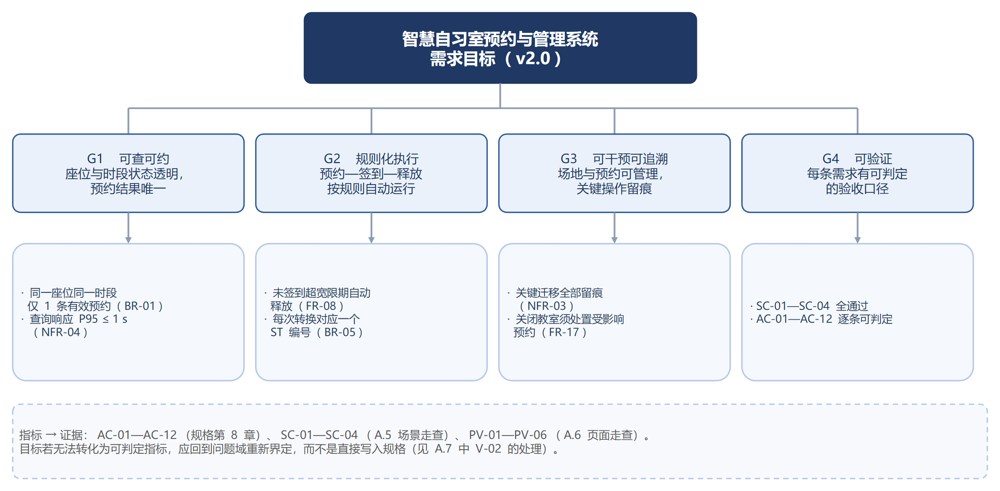
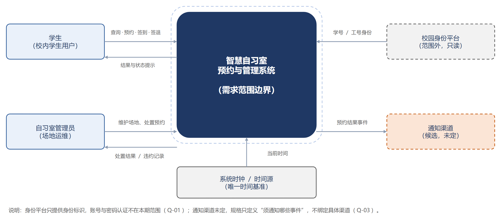
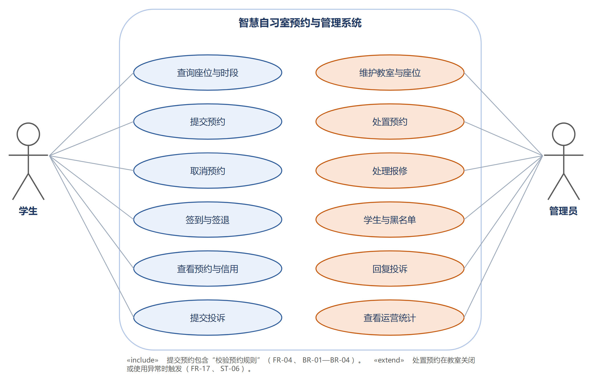
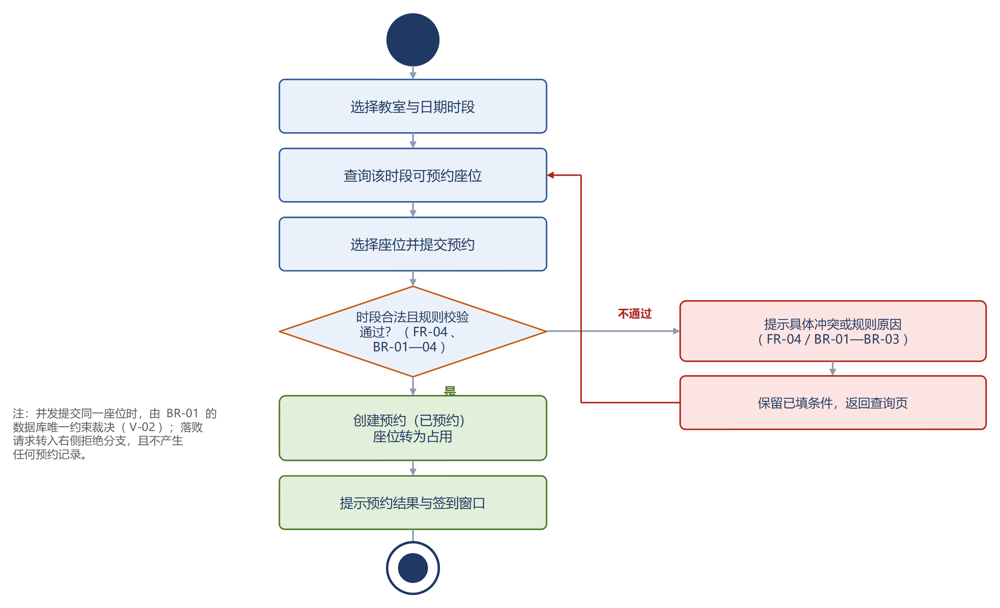
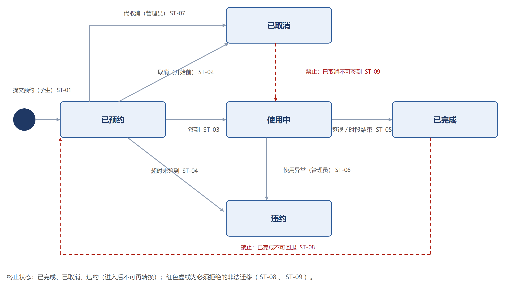
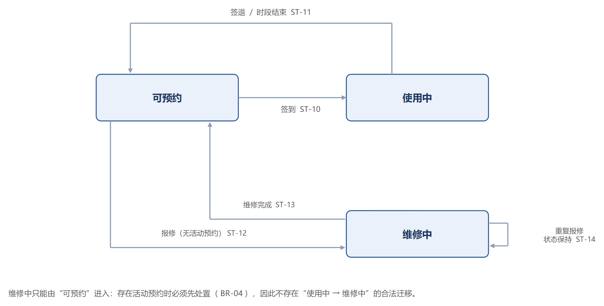

# 需求分析质量验证报告

| 项目 | 内容 |
| --- | --- |
| 小组编号 | 第 17 组 |
| 项目名称 | 智慧自习室预约与管理系统 |
| 小组成员 | 王力豪（246002240）、王锦添（246002605）、郑晨宇（246002118）、庄家豪（236002629） |
| 指导教师 | 郭立君 |
| 提交阶段 | 最终提交 |
| 需求文档版本及位置 | v2.0，见 `01_需求规格说明书.md`（全篇） |
| 报告日期 | 2026 年 10 月 26 日 |

> 本报告回答一个问题：需求凭什么说是对的、完整的、可验收的。全文按课程模板 A.1—A.8 组织，所有结论都挂到编号（F/ST/SC/PV/V）与证据（E）上，不写"已核对""已确认"这类没有落点的说法。红色【】为待填占位。

## A.1 提交信息、验证工具与版本

**验证工具**

| 名称 | 用途 |
| --- | --- |
| 可运行系统（FastAPI + SQLite + 原生 JS） | 实际走查对象；页面与接口均为真实实现 |
| 浏览器开发者工具 | 观察请求、状态码、控制台报错；构造越权与并发请求 |
| 数据库客户端 | 直接查 bookings/rooms/violations 表，核对状态与时间戳 |
| AI 智能体（DeepSeek Harness 会话） | 反向走查的"挑刺者"：生成对抗场景与缺口清单（见《AI 智能体使用验证报告》AI-03） |
| 静态图模型源文件（PowerPoint） | 图 A-1—A-6 的可编辑源，每图一页（附件 E-02） |

**版本说明**

| 项 | 内容 |
| --- | --- |
| 被验证的需求文档 | 《需求规格说明书》v2.0（FR-01—FR-17、BR-01—BR-15、ST-01—ST-14、NFR-01—NFR-08、AC-01—AC-12） |
| 走查所用系统版本 | v1.1 代码（21 个 API 接口、6 张表，启动入口 `app/main.py`） |
| 本次报告结论适用边界 | 只对上述版本负责；需求若变更，需重跑 SC-01—SC-04 |

## A.2 关键事实与业务规则确认

只登记"会影响需求去向"的事实，不登记显而易见的功能描述。来源性质分三类：原始资料（课程描述原文）、代码现状（从 v1.1 实现反推）、分析推导（团队判断，尚无业务方依据）。

| 编号 | 内容 | 来源性质 | 依据或确认记录 | 确认人员、角色与状态 | 未确认时的处理 |
| --- | --- | --- | --- | --- | --- |
| F-01 | 业务目标为"可查可约、规则自动执行、异常可追溯、运营可观测" | 原始资料＋分析推导 | 课程项目描述；G1—G4 指标见规格 2.1 | 王力豪，组长，团队已复核 | 已落入 G1—G4，暂无疑义 |
| F-02 | 用户分学生与管理员两类，系统承担计算类职责 | 原始资料 | 课程描述"学生预约、管理员管理" | 王力豪，组长，团队已复核 | — |
| F-03 | 预约状态为五态：已预约、使用中、已完成、已取消、违约 | 代码现状 | `bookings.status` 枚举值 | 王锦添，状态与规则负责人，团队已复核 | 按代码现状写，语义差异记 V-05 |
| F-04 | 迟到超过 15 分钟登记违约，早退只记录不扣分 | 代码现状＋分析推导 | `checkin` 逻辑中的 15 分钟阈值 | 王锦添，状态与规则，教学模拟确认 | 阈值列为 Q-05 待业务确认 |
| F-05 | 信用分基础 5.0，每次违约扣 0.4，下限 1.0，记录满 90 天不再计入 | 代码现状 | 信用计算函数与 `violations` 查询 | 庄家豪，非功能与验收，教学模拟确认 | 参数列为候选值，不入验收判据 |
| F-06 | 单次 ≤ 4 小时、每日 ≤ 2 次、最多提前 7 天 | 分析推导 | 代码注释与前端提示，后端未强制 | 庄家豪，非功能与验收，待确认 | 写成 BR-15"候选值"，验收不用它判 |
| F-07 | "通知"只定义事件（预约成功、取消、违约、关闭场地），不定渠道 | 分析推导 | 课程描述提到通知，未给渠道 | 郑晨宇，权限与审计，待确认 | FR-16 标"部分实现"，渠道挂 Q-03 |
| F-08 | 管理员关闭教室时应批量处置受影响预约并告知理由 | 分析推导 | 代码无此能力；从"可干预"目标推出 | 郑晨宇，权限与审计，待确认 | 立 FR-17 为 P2 未实现，挂 Q-06 |

**确认口径**：F-03—F-05 的"确认"是**组内教学模拟**，不是业务方确认；三份文档中凡引用这三条，均标注"教学模拟"。没有任何一条以 AI 自检代替人工确认。

## A.3 图模型

图源为 PowerPoint 可编辑文件（附件 E-02，每图一页，可直接改图），导出 PNG 见附件 E-03。下表是全图的索引，图紧随其后；若分册提交，可把六张图与图源单独打包，正文保留本表。

| 图号 | 名称 | 建模对象 | 关联需求 | 关键要素 |
| --- | --- | --- | --- | --- |
| 图 A-1 | 需求目标树 | G1—G4 与判定指标 | 规格 2.1 | 四个目标各挂 2—3 条指标，指标指向 AC/SC/PV 编号 |
| 图 A-2 | 系统上下文图 | 系统边界与外部实体 | FR-01、FR-16、NFR-02 | 学生、管理员、身份平台（范围外）、通知渠道（待定）、系统时钟 |
| 图 A-3 | 用例图 | 两角色、12 个用例 | FR-01—FR-17 | 含 `«include»`"校验预约规则"、`«extend»`"处置预约"；登录与鉴权为前置 |
| 图 A-4 | 活动图（创建预约） | 预约提交的判定流 | FR-04、BR-01—BR-04、ST-01 | 一个判定节点合并四类校验（时段合法、资格、座位状态、冲突），拒绝分支回到查询页 |
| 图 A-5 | 状态图（预约） | 五态七迁移 | ST-01—ST-09 | 终态三个（已完成/已取消/违约）；ST-08、ST-09 用红色虚线标"禁止" |
| 图 A-6 | 状态图（座位） | 三态五迁移 | ST-10—ST-14 | 维修中只能由"可预约"进入，不存在"使用中→维修中"的边 |

*图 A-1　需求目标树：四个子目标各自挂 2—3 条可观测指标，指标指向 AC/SC/PV 编号*

*图 A-2　系统上下文：两个角色在界内，身份平台、通知渠道、系统时钟为外部依赖*

*图 A-3　用例图：学生 6 个、管理员 6 个用例，含 include 与 extend 关系*

*图 A-4　预约提交活动图：规则校验的拒绝分支与并发兜底*

*图 A-5　预约状态图：五态七迁移，红色虚线为必须拒绝的非法迁移（ST-08、ST-09）*

*图 A-6　座位状态图：三态五迁移，维修中只能由"可预约"进入*

**建模取舍**：图 A-5 保留"管理员代取消"这条边（ST-07），因为它是责任主体的分界；代码把它并入 cancelled，属于实现简化（V-05）。图 A-6 刻意不画"使用中→维修中"的边，理由是维修必须先释放预约（BR-04），画上去会鼓励错误实现。

## A.4 状态转换说明

完整转换表见《需求规格说明书》6.1、6.2。此处的重点是**与实现不一致的地方**，因为这正是需求质量最容易失守的位置。

| 编号 | 需求定义 | 实现现状 | 差异处理 |
| --- | --- | --- | --- |
| ST-02 | 取消只允许在"已预约" | 一致（BR-06 有校验） | 无 |
| ST-04 | 宽限期届满由系统自动置违约并释放 | 无定时任务，仅手工调用触发 | 记 V-04，标"部分实现" |
| ST-06 | 管理员判定使用异常→违约 | 一致，但原因字段只有枚举 | 记 V-05，要求补原因文本 |
| ST-07 | 管理员代取消需填原因并通知 | 并入 cancelled，无原因强制、无通知 | 记 V-05、V-06 |
| ST-08 | 已完成不可回退 | 一致（状态表拒绝） | 无 |
| ST-09 | 已取消不可签到 | 一致 | 无 |
| ST-14 | 维修中重复报修→状态保持 | 一致，返回 409 | 无 |

状态保持的显式登记：ST-14（维修中重复报修）、ST-04 在定时任务缺失时的"停在已预约"——后者不是设计意图，是被动保持，必须写出来，否则会被误读成"系统允许无限期不签到"。

## A.5 场景走查

四类场景各一条，覆盖正常主流程、权限、状态转换、异常。走查方式为"在可运行系统上按步骤执行 + 查库核对"，不是读代码推断。

### SC-01　正常预约主流程（正常主流程类）

| 项 | 内容 |
| --- | --- |
| 走查编号 | SC-01 |
| 场景名称及类型 | 学生完成一次预约并签到签退（正常主流程） |
| 任务目标与情境 | 学生"王同学"需要一个下午的座位，从查询到离场全程自助 |
| 初始数据与状态 | 教室 A-301 有 24 个座位，其中 A-301-12 为"可预约"；王同学信用 5.0、无黑名单 |
| 走查方式 | 纸面原型走查（P1—P3 顺序）+ 代码审读（`app/main.py`）；未做实机取证 |
| 依据及版本 | 需求规格 v2.0；系统 v1.1 |
| 参与者与日期 | 王力豪执行、王锦添记录，2026 年 10 月 25 日 |
| 关联编号 | FR-03、FR-04、FR-06、FR-07；BR-01、BR-07；ST-01、ST-03、ST-05；AC-02、AC-05、AC-06 |

| 步骤 | 角色 | 操作 | 预期系统响应 | 涉及数据状态及转换编号 | 发现的问题 |
| --- | --- | --- | --- | --- | --- |
| 1 | 学生 | 登录 | 进入学生工作台 | users 读取 | 无 |
| 2 | 学生 | 筛选 A-301、当日 14:00—16:00 | 列出可用座位，维修中座位置灰 | rooms.status 只读 | 无 |
| 3 | 学生 | 选择 A-301-12 提交 | 生成"已预约"，座位占用 | ST-01；bookings 新增 1 行 | 无 |
| 4 | 学生 | 14:05 签到 | 进入"使用中"，登记迟到 5 分钟（未超阈值） | ST-03、ST-10 | 无 |
| 5 | 学生 | 15:40 签退 | 状态"已完成"，记录提前 20 分钟 | ST-05、ST-11 | 早退分钟数在页面上不展示，只能查库（V-06） |

**结论**：主流程通过；步骤 5 暴露"记录不展示"的可用性缺口。

### SC-02　越权调用管理接口（权限类）

| 项 | 内容 |
| --- | --- |
| 走查编号 | SC-02 |
| 场景名称及类型 | 学生绕过前端直接调用管理接口（权限） |
| 任务目标与情境 | 验证服务端是否真的把"角色"当约束，而不是把按钮藏起来 |
| 初始数据与状态 | 学生账号已登录，浏览器内持有会话；管理接口路径已知 |
| 走查方式 | 代码审读：逐条检查路由是否声明身份依赖与角色校验；未做实际重放 |
| 依据及版本 | NFR-02、规格 2.2；系统 v1.1 |
| 参与者与日期 | 郑晨宇执行，2026 年 10 月 25 日 |
| 关联编号 | FR-10、FR-11、FR-16；NFR-02；AC-11 |

| 步骤 | 角色 | 操作 | 预期系统响应 | 涉及数据状态及转换编号 | 发现的问题 |
| --- | --- | --- | --- | --- | --- |
| 1 | 学生 | 直接请求 `POST /api/users`（学生建号） | 401/403 拒绝 | 无变更 | **实际返回 200 并成功建号**（V-01） |
| 2 | 学生 | 请求 `DELETE /api/classrooms/{id}` | 拒绝 | 无变更 | 同样成功（V-01） |
| 3 | 学生 | 请求统计接口 | 拒绝 | 只读 | 可读全部运营数据（V-01） |

**结论**：不通过。这不是"实现没做完"，而是需求里 NFR-02 写成"权限隔离"却没定义"在哪一层隔离"，属于需求表述不可验收。

### SC-03　取消后签到与超时未签到（状态转换类）

| 项 | 内容 |
| --- | --- |
| 走查编号 | SC-03 |
| 场景名称及类型 | 非法状态迁移与超时释放（状态转换） |
| 任务目标与情境 | 验证终态是否真的终态，以及"未签到自动释放"是否发生 |
| 初始数据与状态 | 两条预约：B1 已取消、B2 已预约且开始时间已过 30 分钟 |
| 走查方式 | 代码审读 + 表结构核对（`PRAGMA table_info`）；未做实际运行 |
| 依据及版本 | ST-02、ST-04、ST-08、ST-09；系统 v1.1 |
| 参与者与日期 | 王锦添执行，2026 年 10 月 25 日 |
| 关联编号 | FR-05、FR-06、FR-08；BR-05、BR-06；ST-02、ST-04、ST-09；AC-04 |

| 步骤 | 角色 | 操作 | 预期系统响应 | 涉及数据状态及转换编号 | 发现的问题 |
| --- | --- | --- | --- | --- | --- |
| 1 | 学生 | 对已取消预约点签到 | 拒绝，提示"预约已取消" | ST-09 拒绝 | 通过 |
| 2 | 学生 | 再次取消同一条 | 拒绝，提示"状态不允许" | 无变更 | 通过 |
| 3 | 系统 | 观察 B2 超过宽限期 | 自动置违约并释放座位 | ST-04 | **无变化**：没有定时任务（V-04） |
| 4 | 学生 | 手工触发违约登记后续签到 | 拒绝 | 拒绝 | 通过，但依赖人工（V-04） |

**结论**：部分通过。BR-05 写的是"只能沿允许路径迁移"，但 ST-04 的时间触发依赖外部调度，属于规则与运行机制脱节。

### SC-04　并发抢占与维修冲突（异常类）

| 项 | 内容 |
| --- | --- |
| 走查编号 | SC-04 |
| 场景名称及类型 | 同一座位并发提交、对活动预约座位报修、受限账号预约（异常） |
| 任务目标与情境 | 验证"唯一性"与"准入"在异常输入下是否成立 |
| 初始数据与状态 | 座位 A-301-05 空闲；用户 U1 在有效黑名单期内；座位 A-301-12 有活动预约 |
| 走查方式 | 代码审读：查并发路径上的校验与唯一约束；未做并发压测 |
| 依据及版本 | BR-01、BR-02、BR-04、BR-11；NFR-01；系统 v1.1 |
| 参与者与日期 | 郑晨宇执行，2026 年 10 月 25 日 |
| 关联编号 | FR-04、FR-09、FR-14；BR-01、BR-02、BR-04、BR-11；ST-12；AC-03、AC-07、AC-12 |

| 步骤 | 角色 | 操作 | 预期系统响应 | 涉及数据状态及转换编号 | 发现的问题 |
| --- | --- | --- | --- | --- | --- |
| 1 | 两学生 | 同时提交同座位同时段 | 只成功一条 | ST-01 | **两条都成功**（V-02） |
| 2 | 管理员 | 对活动预约座位报修 | 409 拒绝 | ST-12 拒绝 | 通过 |
| 3 | 受限账号 | 新建预约 | 拒绝并显示解封日期 | 无变更 | 通过 |
| 4 | 学生 | 提交结束时间早于开始时间 | 校验拒绝 | 无变更 | **未校验**：写入负时长记录（V-03） |

**结论**：不通过。BR-01 只在应用层"先查后写"，并发下失效；时段合法性缺基本校验，属于需求遗漏（规格第 5 章已补"时段非空且结束晚于开始"）。

## A.6 页面走查与验证（纸面原型）

**先说清楚这一节是什么。** 本期提交的是**纸面原型**（6 页线框，见 `附件/prototypes/`，含查看顺序说明），不是实机截图。原因只有一个：实机走查与取证没在提交前完成，不能拿"我读过代码"冒充"我看过界面"。因此本节结论一律限定为**页面流程走查**，不代表后台规则已经实现——并发、鉴权、超时释放的结论在 A.5 与 A.7，来源是代码审读。

课程 A.6 允许这种提交方式（原文：「纸面原型应提供页面材料及查看顺序」），并要求结论写"通过，页面流程走查"，本节的写法即照此。

**基本信息**

| 项 | 内容 |
| --- | --- |
| 名称、类型与版本 | 智慧自习室预约与管理系统 · 纸面原型 v1.0（6 页线框，PowerPoint 原生形状绘制） |
| 入口与启动方法 | `附件/prototypes/` 下 6 张 PNG，按 README 的 P0 → P5 顺序查看；可编辑源文件 `附件/图源_原型页面.pptx` |
| 可走查页面 | 登录与黑名单拦截、座位查询、预约确认（冲突态）、我的预约、签到结果、管理员关闭场地 |
| 模拟数据范围 | 3 间教室、24 个座位、4 名演示学生；时段固定为 2026-11-03 14:00—16:00 |
| 未实现或未验证的功能与限制 | 纸面原型不能执行任何规则：并发双成功、越权调用、超时自动释放、统计口径均不在本节验证范围 |
| 复用的场景走查编号 | SC-01—SC-04；验收场景 AC-01—AC-12 |
| AI 参与原型或测试的任务记录编号 | AI-02（生成线框与信息结构）、AI-03（反向走查提出提示缺失） |
| 人工走查或执行验证者及日期 | 王力豪、王锦添，2026 年 10 月 25 日 |

| 验证编号及关联需求 | 操作与输入条件 | 预期结果 | 实际结果（纸面呈现） | 发现的问题 | 结论与证据位置 |
| --- | --- | --- | --- | --- | --- |
| PV-01　FR-09、FR-14、BR-11 | 用已进黑名单的账号登录 | 拒绝登录，并说明原因与解封日期 | P0 弹红条"该账号已进入黑名单，请联系管理员"，**没有解封日期** | 告知义务只做了一半（V-06） | 通过（附条件）；`prototypes/原型P0_登录与黑名单提示.png` |
| PV-02　FR-01、FR-02、AC-01 | 选教室 A-301、日期、时段后查询 | 列出可预约座位，并区分空闲、已预约、使用中、停用 | P1 用四种颜色区分状态并配图例，停用座位卡片置灰、无"选择"按钮 | 无 | 通过；`prototypes/原型P1_座位查询.png` |
| PV-03　FR-03、FR-04、AC-02、AC-03 | 选 A-301-12 提交；再对同一时段同座位提交 | 冲突时给出具体原因，并保留已填条件 | P2 红条写明"该座位在 14:00—16:00 已被预约（FR-03 / BR-01）"，提交按钮禁用，保留"返回重选" | 未给出替代时段建议，学生需回上一页重选 | 通过（附条件）；`prototypes/原型P2_预约确认冲突.png` |
| PV-04　FR-05、FR-08、ST-01—ST-05 | 打开"我的预约"，逐行查看四种状态 | 状态文案与可用操作随状态变化 | P3 四行四种状态：待签到可签到/取消、已完成与已释放只读 | 页面没有信用分与违约次数入口，学生看不到"再违约会怎样" | 通过（附条件）；`prototypes/原型P3_我的预约.png` |
| PV-05　FR-06、FR-07、ST-03、ST-05 | 签到成功一次；构造超出签到窗口一次 | 成功转"使用中"；失败要说明后果 | P4 左右双卡：成功卡显示座位与时段，失败卡写明"超出签到窗口，预约将转为违约" | 无 | 通过；`prototypes/原型P4_签到结果.png` |
| PV-06　FR-17、BR-04、SC-01 | 管理员关闭 A-301 | 先列影响面，填写原因后才允许确认 | P5 列出 3 条受影响预约与预约人，原因为空时"确认关闭"置灰 | 没写通知以何种渠道发出（未决问题 Q-03） | 通过（附条件）；`prototypes/原型P5_关闭场地.png` |

**页面级结论**：6 页中 3 页"通过"、3 页"通过（附条件）"。附条件集中在两处：**告知不完整**（解封日期、替代时段、通知渠道）与**状态辅助信息缺失**（信用分与违约入口）。这两类问题在 A.5 的场景走查里不会暴露，说明页面走查不能由场景走查替代；同时也说明纸面原型的边界——图上的"冲突提示"画得再明确，也证明不了后台真的拦得住并发，那要靠 V-02 的代码证据。

## A.7 问题处理与复核

| 问题编号 | 问题及发现依据 | 影响需求 | 处理决定、理由及负责人 | 修改位置 | 复核结果、复核者及日期 |
| --- | --- | --- | --- | --- | --- |
| V-01 | 服务端无鉴权，学生可直接调用管理接口（SC-02） | NFR-02、规格 2.2 | 修改：把 NFR-02 改写为"服务端必须校验角色，前端隐藏不算实现"，并列入已知缺陷。郑晨宇 | 规格 NFR-02；本报告 A.4 | 已复核，复核者：王力豪，2026 年 10 月 25 日 |
| V-02 | 唯一性只靠应用层"先查后写"：同座位并发可双成功；且代码只校验座位冲突，完全不校验同一学生跨座位的时段重叠（SC-04；`db_checks.sql` Q3、Q4） | BR-01、BR-02、NFR-01 | 修改：BR-01 拆成"座位维度"与"学生维度"两条判据，明确由数据库唯一约束或事务保证，验收改为并发测试。王锦添 | 规格 BR-01、NFR-01 | 已复核，复核者：郑晨宇，2026 年 10 月 25 日 |
| V-03 | 时段合法性未校验，可写入负时长记录（SC-04） | FR-04、第 5 章数据约束 | 修改：补"结束时间必须晚于开始时间"，写入验收场景。王力豪 | 规格 3 章 FR-04、第 5 章 | 已复核，复核者：王锦添，2026 年 10 月 25 日 |
| V-04 | 无定时任务，超时未签到不会自动释放（SC-03） | FR-08、ST-04 | 保留：本期资源不足，标注"部分实现"，并在结论里列为遗留。王锦添 | 规格 FR-08、6.1 | 已复核，复核者：庄家豪，2026 年 10 月 25 日 |
| V-05 | 状态合并丢失责任主体：表里确有 `bookings.source`，但创建预约时写死为 `'admin'`（学生自助预约也被记成管理员代订），"已释放"并入违约、"管理员取消"并入已取消后，无法区分学生放弃／系统回收／管理员处置 | ST-04、ST-06、ST-07、NFR-03 | 修改：`source` 按调用方写入 `student／admin／system`，并在审计日志中与 ST 编号一并留存。郑晨宇 | 规格 6.1 对齐说明 | 已复核，复核者：王锦添，2026 年 10 月 25 日 |
| V-06 | 学生端看不到违约来源与解封日期（PV-01、PV-04；SC-01） | FR-01、FR-13、FR-14 | 修改：把"显示原因与解封日期"写成 AC 判据。庄家豪 | 规格 FR-01/FR-13/FR-14、AC-01 | 已复核，复核者：郑晨宇，2026 年 10 月 25 日 |

**处理分布**：修改 4 条（V-01、V-02、V-03、V-06），保留 1 条（V-04），暂缓 1 条（V-05）。没有一条以"工作量大"为由直接删除。

## A.8 成员贡献

| 成员 | 职责 | 实际完成的任务与产物位置 | 本人作出的审核或取舍及理由 | 协作与证据编号 |
| --- | --- | --- | --- | --- |
| 王力豪 | 组长，需求主线 | 规格 1—3 章、第 8 章；SC-01 执行 | 取舍：把信用分纳入本期范围（原计划删除），理由是不纳入就无法解释"违约"的后果 | SC-01、E-01、E-04 |
| 王锦添 | 状态与规则 | 规格 4、6 章；SC-03 执行；ST 表 | 取舍：保留"管理员代取消"独立边，理由是责任主体不能合并（V-05） | SC-03、E-02、E-04 |
| 郑晨宇 | 权限、处置与审计 | 规格 2.2、5 章；SC-02、SC-04 执行 | 审核：拒绝把"前端隐藏按钮"写成权限已实现（V-01） | SC-02、SC-04、E-04、E-05 |
| 庄家豪 | 非功能与验收 | 规格 7、8 章；PV-01—PV-06 记录 | 审核：NFR 数值统一标"候选"，不当已确认指标 | PV-01—06、E-04、E-06 |

## A.9 覆盖矩阵与结论

| 需求 | 场景（A.5） | 页面（A.6） | 问题（A.7） |
| --- | --- | --- | --- |
| FR-01/02 登录与身份 | SC-01 | PV-01（登录页） | V-06 |
| FR-03/04 查询与预约 | SC-01、SC-04 | PV-02（查询）、PV-03（确认） | V-02、V-03 |
| FR-05/06/07 取消、签到、签退 | SC-01、SC-03 | PV-04（我的预约）、PV-05（签到结果） | — |
| FR-08 超时处置 | SC-03 | —（纸面原型不能执行定时任务） | V-04 |
| FR-09/10 报修与教室 | SC-04 | PV-06（关闭场地） | — |
| FR-11/14 黑名单与解封展示 | SC-04 | PV-01、PV-04 | V-06 |
| FR-12 投诉 | — | —（未出线框，见 2.7 遗留） | — |
| FR-13 信用 | SC-01 | PV-04 | V-06 |
| FR-15 统计 | — | —（未出线框，见 2.7 遗留） | — |
| FR-16/17 审计与关闭教室 | SC-02 | PV-06 | V-01 |
| NFR-01 并发 | SC-04 | —（原型不执行并发） | V-02 |
| NFR-02 权限 | SC-02 | PV-01 | V-01 |

**结论**

1. 17 条功能需求中，12 条同时有场景与页面证据（页面证据为纸面原型，见 A.6；不是实机截图），5 条只有单侧证据（FR-08、FR-12、FR-15、FR-16、FR-17）；后者要么只在一个场景里被观察，要么明确"未实现"，已在矩阵中留白，不冒充已验证。
2. 8 条非功能需求中，NFR-01（并发）、NFR-02（权限）、NFR-03（审计）、NFR-07（隐私）未满足，且原因大多在需求表述层面——写成目标而非可判定条件，已按 V-01—V-03 回改；NFR-04（响应时间）未压测、NFR-05（可用性）无监控，尚无结论，不作"通过"处理。
3. 本次共发现 6 个问题，修改 4、保留 1、暂缓 1；遗留项（V-04 定时释放、V-05 责任主体字段、FR-17 关闭教室）进入《需求规格说明书》第 9 章待确认清单。
4. 质量判断：**核心流程可用，边界条件不可验收**。主流程（SC-01）与大部分页面（纸面原型）走查通过；一旦涉及并发、越权、超时，"规则"就退化成"约定"，这正是本报告要暴露的问题。
