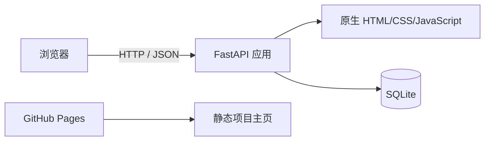

# 智慧自习室预约与管理系统项目说明

> 文档日期：2026-11-08
> 项目定位：面向校内自习室场景的预约与运营管理工作台
> 技术形态：FastAPI 单体应用 + SQLite + 原生 JavaScript 单页界面

## 1. 项目简介

本项目围绕自习室座位资源建设一套可运行的管理闭环，覆盖“教室与座位资源、预约与签到签退、座位维修、投诉反馈、违约记录、履约信用和运营统计”。系统同时提供管理员工作台和学生服务入口，适合课程设计、功能演示和小规模本地使用。

项目当前目标是清晰展示完整业务流程和前后端协作，而不是提供直接可用的生产级 SaaS 系统。代码、数据库迁移、接口、页面交互和演示数据都在同一个仓库中，首次启动即可运行。

## 2. 建设目标

- 统一管理教室和实体座位，避免手工维护容量和开放状态。
- 让学生完成预约、取消、签到、签退、投诉和信用查询。
- 让管理员集中处理预约、学生、座位维修、投诉和违约记录。
- 用违约记录和信用分形成可解释的履约约束。
- 通过统计图表展示预约趋势、区域分布、热门座位和爽约率。
- 提供可重复演示的本地环境、Git 流程和 GitHub Pages 项目主页。

## 3. 角色与能力

| 角色 | 主要能力 | 数据范围 |
| --- | --- | --- |
| 学生 | 登录、创建预约、查看本人预约、取消预约、签到、签退、查看信用、提交投诉或申诉、修改密码 | 本人预约、本人信用、本人投诉、公开座位状态 |
| 管理员 | 查看运营总览、管理预约、座位、教室、学生、投诉和违约记录，代学生处理预约状态 | 全部业务数据 |
| 系统规则 | 初始化演示数据、同步教室容量、计算信用分、处理过期黑名单、生成违约记录 | 全量业务数据 |
| 未登录访问者 | 查看 GitHub Pages 项目介绍页和静态资源 | 公开项目信息 |

管理员和学生演示账号见 `docs/accounts.md`。该清单仅用于本地演示，不应发布到正式环境。

## 4. 技术架构



### 技术栈

| 层次 | 技术 | 说明 |
| --- | --- | --- |
| 前端 | 原生 HTML、CSS、JavaScript | 无前端构建步骤，单页界面由 `app/static/app.js` 渲染 |
| 图标 | Lucide CDN | 页面通过 `unpkg.com` 加载图标 |
| 后端 | Python、FastAPI、Pydantic | 路由、静态资源、请求校验和业务逻辑集中在 `app/main.py` |
| 数据库 | SQLite | 单文件数据库，首次启动自动建表并写入演示数据 |
| 运行服务器 | Uvicorn | 默认监听 `127.0.0.1:8000` |
| 依赖管理 | uv | 由 `pyproject.toml` 和 `uv.lock` 管理 |
| 静态发布 | GitHub Actions + GitHub Pages | 发布仓库根目录的 `index.html` 项目介绍页 |

### 目录结构

| 路径 | 用途 |
| --- | --- |
| `app/main.py` | 应用入口、数据表初始化、业务函数和全部 API 路由 |
| `app/static/index.html` | 应用页面壳 |
| `app/static/app.js` | 登录、页面渲染、表单提交、API 调用和自动刷新 |
| `app/static/style.css` | 基础视觉样式 |
| `app/static/overrides.css` | 业务页面、响应式布局和局部交互样式 |
| `pyproject.toml` | Python 项目元数据与直接依赖 |
| `uv.lock` | 依赖锁定文件 |
| `Start.bat` | Windows 快速启动脚本 |
| `README.md` | 快速开始与功能摘要 |
| `docs/环境清单.md` | 开发、运行和验证环境要求 |
| `docs/accounts.md` | 本地演示账号清单 |
| `index.html` | GitHub Pages 项目介绍页 |
| `.github/workflows/pages.yml` | GitHub Pages 自动部署工作流 |

## 5. 功能模块

### 5.1 管理员工作台

- **运营总览**：展示今日预约量、当前使用中座位、活跃学生、待处理投诉、维修座位、预约趋势、区域分布、热门座位和爽约率。
- **预约管理**：查询和筛选预约，创建预约，执行签到、签退、取消和违约处理。
- **座位资源**：查看所有实体座位及状态，搜索和筛选座位，查看座位历史，执行报修和恢复可用。
- **教室管理**：新增、编辑和删除教室，展示关联座位数量和状态汇总。
- **学生管理**：新增、编辑、删除学生，管理受限账号、解封日期、限制原因和信用详情。
- **投诉与反馈**：查看投诉、报修、建议和账号申诉，更新处理状态并回复学生。
- **违规记录**：查看自动和人工登记的违约记录，手动为学生登记违约。

### 5.2 学生服务

- 查看本人预约记录和座位状态。
- 创建预约、取消预约、签到和签退。
- 提交投诉、报修、建议或账号申诉，并查看管理员回复。
- 查看履约信用分、信用等级、违约明细和预计恢复日期。
- 查看账号限制原因、解封日期和剩余天数。
- 修改登录密码。
- 查看用户中心中的个人资料和账号状态。

### 5.3 统计与实时刷新

前端每 10 秒重新请求业务数据。预约趋势按近 7 天聚合；区域分布按座位名称首字母分组；热门座位按有效预约次数排序；爽约率按违约预约占有效预约的比例计算。

自动刷新期间，如果存在弹窗或正在编辑的投诉表单，页面不会立即销毁当前表单，以减少输入内容被覆盖的问题。

## 6. 核心业务规则

### 6.1 座位状态

| 状态 | 含义 | 可执行操作 |
| --- | --- | --- |
| `open` | 可预约 | 可以创建预约、签到和报修 |
| `occupied` | 使用中 | 完成签退或异常处理后恢复开放 |
| `maintenance` | 维修中 | 暂停预约，维修完成后由管理员恢复 |

有活动预约或正在使用的座位不能直接进入维修状态。教室容量来自关联实体座位数量；当教室内存在非维修座位时，教室显示为开放。

### 6.2 预约状态

```text
booked（已预约）
├── checked_in（使用中）
│   ├── completed（已完成）
│   └── violation（违约）
├── cancelled（已取消）
└── violation（违约）
```

| 状态 | 说明 |
| --- | --- |
| `booked` | 已创建预约，等待签到 |
| `checked_in` | 已签到，座位进入使用中 |
| `completed` | 已签退，记录提前分钟数 |
| `cancelled` | 已取消，释放座位 |
| `violation` | 未签到或使用异常，生成违约记录并影响信用 |

后端通过状态转换表限制非法变更。已完成、已取消和已违约记录不能继续流转。

### 6.3 预约冲突与限制

当前后端会校验：

- 用户和座位必须存在。
- 座位必须处于可预约状态。
- 受限账号不能创建预约。
- 同一座位的有效预约时段不能重叠。

当前版本尚未强制实现单次时长、每日预约次数、最多提前天数、学生跨座位冲突和定时释放未签到预约等扩展规则。

### 6.4 签到、签退和违约

- 签到时间早于或等于预约结束时间时才允许签到。
- 签到超过开始时间 15 分钟会生成迟到违约记录。
- 签退会记录提前分钟数，但提前签退不自动扣信用分。
- 未签到违约和使用期间违规会写入 `violations` 表并同步信用分。
- 管理员可以代学生执行签到、签退、取消和违约处理。

### 6.5 履约信用

| 规则 | 值 |
| --- | --- |
| 基础分 | 5.0 |
| 每次有效违约扣分 | 0.4 |
| 最低分 | 1.0 |
| 违约记录恢复期 | 90 天 |

信用分按最近 90 天内的有效违约次数计算。超过 90 天的违约记录不再参与扣分，信用分会在读取用户或信用信息时重新同步。

### 6.6 黑名单与账号限制

受限学生仍可登录并查看账号状态、信用和提交申诉，但不能创建预约。管理员可以设置限制原因和解封日期；未填写解封日期时默认设置为 7 天后。应用在登录、总览和用户相关请求中会释放已过期黑名单。

### 6.7 投诉反馈

投诉记录支持分类、关联座位、主题、详细内容、处理状态和管理员回复。学生只能查询本人反馈；管理端可以查看全部反馈并更新状态。座位报修和账号申诉复用同一套投诉数据模型。

## 7. 数据模型

| 表 | 关键字段 | 关系与用途 |
| --- | --- | --- |
| `classrooms` | 名称、楼栋、楼层、容量、状态、设施 | 教室主数据，容量由座位自动汇总 |
| `rooms` | 座位编号、教室、楼层、状态、设施、维修说明 | 一对多关联教室，座位是预约资源 |
| `users` | 姓名、学号、密码、违约次数、信用分、黑名单字段 | 学生账号、履约状态和预约主体 |
| `bookings` | 用户、座位、起止时间、状态、签到、签退、迟到、早退 | 预约生命周期记录 |
| `complaints` | 用户、座位、分类、主题、内容、状态、回复 | 投诉、报修、建议和申诉 |
| `violations` | 用户、预约、原因、来源、时间 | 信用扣分和违规追踪依据 |

主要关系：

- 一个教室可以包含多个座位。
- 一个学生可以创建多个预约。
- 一个座位可以产生多条历史预约。
- 一个学生可以提交多条投诉。
- 一个学生可以产生多条违约记录，违约记录可以关联预约。

当前数据库通过外键和唯一学号约束维护基本一致性。预约时段重叠仍由应用层先查询再写入，没有数据库唯一索引或事务锁，高并发下存在重复预约风险。

## 8. 后端接口

后端共有 26 个路由，包括应用首页和 25 个 API。接口统一使用 JSON；CSV 导入使用 `multipart/form-data`。

| 模块 | 方法与路径 | 用途 |
| --- | --- | --- |
| 页面 | `GET /` | 返回单页应用入口 |
| 登录 | `POST /api/auth/login` | 学生或管理员登录 |
| 密码 | `PATCH /api/users/{user_id}/password` | 修改当前学生密码 |
| 总览 | `GET /api/overview` | 获取运营总览数据 |
| 教室 | `GET /api/classrooms` | 查询教室和座位汇总 |
| 教室 | `POST /api/classrooms` | 新增教室 |
| 教室 | `PATCH /api/classrooms/{classroom_id}` | 编辑教室 |
| 教室 | `DELETE /api/classrooms/{classroom_id}` | 删除教室 |
| 座位 | `GET /api/rooms` | 查询全部座位 |
| 座位 | `PATCH /api/rooms/{room_id}/status` | 报修或恢复座位 |
| 预约 | `GET /api/bookings` | 查询预约，可按状态和用户过滤 |
| 预约 | `POST /api/bookings` | 创建预约 |
| 预约 | `PATCH /api/bookings/{booking_id}/status` | 更新预约状态 |
| 学生 | `GET /api/users` | 查询学生列表 |
| 学生 | `GET /api/users/{user_id}/account-status` | 查询账号状态和黑名单信息 |
| 信用 | `GET /api/users/{user_id}/credit-profile` | 查询信用详情 |
| 学生 | `POST /api/users` | 新增学生 |
| 学生 | `PATCH /api/users/{user_id}` | 编辑学生和黑名单信息 |
| 学生 | `DELETE /api/users/{user_id}` | 删除学生 |
| 导入 | `POST /api/users/import` | 通过 CSV 批量导入学生 |
| 违约 | `GET /api/violations` | 查询违约记录 |
| 违约 | `POST /api/violations` | 手动登记违约 |
| 投诉 | `GET /api/complaints` | 查询投诉，可按用户过滤 |
| 投诉 | `POST /api/complaints` | 提交投诉、报修或申诉 |
| 投诉 | `PATCH /api/complaints/{complaint_id}` | 更新状态和回复 |
| 统计 | `GET /api/analytics` | 查询趋势、区域分布、热门座位和爽约率 |

## 9. 前端页面

| 角色 | 页面 | 说明 |
| --- | --- | --- |
| 公共 | 登录页 | 学生和管理员切换登录 |
| 管理员 | 运营总览 | 指标卡、趋势图、区域分布、热门座位和提醒 |
| 管理员 | 预约管理 | 预约查询、创建和状态处理 |
| 管理员 | 座位资源 | 座位地图、筛选、报修、恢复和座位历史 |
| 管理员 | 教室管理 | 教室增删改和容量汇总 |
| 管理员 | 学生管理 | 学生增删改、黑名单和 CSV 导入 |
| 管理员 | 投诉与反馈 | 处理状态和回复 |
| 管理员 | 违规记录 | 违约列表和手动登记 |
| 学生 | 我的预约 | 创建预约和查看本人预约 |
| 学生 | 投诉建议 | 提交反馈和查看回复 |
| 学生 | 履约信用 | 查看评分、规则和违约明细 |
| 学生 | 用户中心 | 查看资料、账号限制和解封倒计时 |
| 学生 | 修改密码 | 校验原密码并更新密码 |

## 10. 运行与部署

### 本地运行

```powershell
uv sync
uv run uvicorn app.main:app --host 127.0.0.1 --port 8000 --reload
```

访问 <http://127.0.0.1:8000/>。详细环境要求见 `docs/环境清单.md`。

### GitHub Pages

根目录 `index.html` 是项目介绍页，GitHub Actions 工作流 `.github/workflows/pages.yml` 在 `main` 分支更新或手动触发时部署静态站点。GitHub Pages 只发布静态介绍页，不能运行 FastAPI、SQLite 或任何后端接口。

### 数据库部署边界

应用使用本地文件数据库 `app/study_room.db`。它适合本地演示和单进程运行，不适合多个应用实例同时写入。正式部署应更换数据库，并将数据库路径、账号和密钥改为环境配置。

## 11. 演示流程建议

1. 启动应用并打开登录页。
2. 使用管理员账号进入运营总览，观察座位、预约、投诉和违约指标。
3. 在座位资源中查看可预约、使用中和维修中座位，演示报修与恢复。
4. 在预约管理中创建预约，再演示签到、签退、取消和违约状态。
5. 在学生管理中查看信用详情、黑名单状态和解封日期。
6. 以学生身份登录，查看本人预约、提交投诉、查看信用和修改密码。
7. 回到管理员工作台，处理学生投诉并确认状态同步。
8. 打开 GitHub Pages 页面，展示项目主页、PR 流程和发布记录。

## 12. 当前限制

- 后端接口没有统一的会话令牌、角色中间件或服务端授权校验。
- 管理员账号是固定演示账号，学生密码以明文保存。
- 预约冲突依赖应用层查询，缺少数据库级并发保护。
- 没有定时任务自动扫描所有超时未签到预约。
- 没有独立审计日志、通知记录表、数据保留策略和敏感字段脱敏。
- 没有自动化测试目录；当前验证以编译检查、JS 语法检查和人工/API 冒烟为主。
- 没有单次时长、每日预约次数、提前预约天数等完整预约限制。
- GitHub Pages 只能展示静态介绍页，不能替代后端运行环境。

## 13. 后续优化建议

1. 增加服务端登录会话、权限中间件和接口级授权。
2. 使用密码哈希并分离演示数据和正式数据。
3. 为预约冲突增加事务和数据库约束，必要时迁移到 PostgreSQL 等服务型数据库。
4. 增加超时未签到、信用恢复和黑名单过期的定时任务。
5. 增加 API 自动化测试、页面回归测试和测试数据隔离。
6. 增加审计日志、通知记录、操作追踪和备份策略。
7. 完善预约时长、每日次数、提前天数和学生跨座位冲突规则。

## 14. 验证现状

当前代码已完成以下检查：

```powershell
node --check app/static/app.js
uv run python -m py_compile app/main.py
git diff --check
```

本地启动验证结果：

- `GET /` 返回 HTTP 200。
- `GET /api/overview` 能返回座位、预约、用户、投诉和违约统计。
- `GET /api/rooms` 能返回座位列表。
- `POST /api/auth/login` 能完成管理员演示登录。

详细环境、启动命令和排障事项见 `docs/环境清单.md`。
